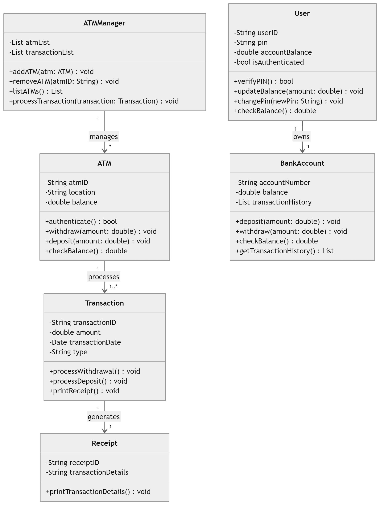

<div align="center">


# Bilal Bank ATM: Withdrawal Simulator

**A front-end prototype of an ATM cash-withdrawal flow, from PIN entry to receipt**


**[▶ Live demo](https://gintoki123.github.io/Atm-Withdrawal/)**

</div>

---

## Overview

A UI/UX project that models the screens a customer goes through to withdraw cash at an ATM. The design was planned first (UML class diagram and slide deck in [`docs/`](docs)) and then built as plain HTML, CSS and JavaScript, with no frameworks.

## User flow

```
PIN entry  ──►  Main menu  ──►  Choose amount  ──►  Success + receipt
(index.html)    (menu.html)     (withdraw.html)     (receipt.html)
```

1. **PIN entry**: accepts any 4-digit PIN and validates the format.
2. **Main menu**: Deposit, Withdraw, Transfer, Balance Enquiry, Change PIN, Exit.
3. **Withdraw**: quick amounts ($100, $200, $500, $1000) and a live balance check that blocks overdrafts.
4. **Receipt**: shows the amount withdrawn, the previous balance and the remaining balance. The customer can download a text receipt.

The balance is kept in the browser's `localStorage`, so it carries across the screens. Starting balance: $150,000 (demo data).

## Run locally

No build step is needed. Clone the repo and open `index.html` in any browser:

```bash
git clone https://github.com/gintoki123/Atm-Withdrawal.git
```

## Project structure

```
Atm-Withdrawal/
├── index.html      # PIN entry
├── menu.html       # Main menu
├── withdraw.html   # Amount selection + balance logic
├── receipt.html    # Confirmation and downloadable receipt
├── assets/
│   └── logo.png
└── docs/
    ├── class-diagram.png  # UML class diagram
    ├── ui-design.pdf      # UI design presentation (PDF)
    └── ui-design.pptx     # UI design presentation (PowerPoint)
```

## Design (UML class diagram)

<p align="center"></p>

## Author

**Bilal Boulaalam** · [GitHub](https://github.com/gintoki123)
